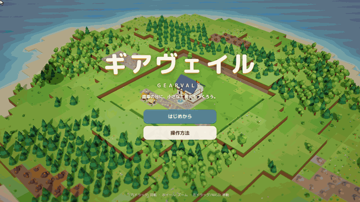

# ギアヴェイル（Gearvale）

> 丸太を運ぶベルトを1本敷くところから始めて、パン工房と製錬炉が動く「都市」まで育てる、ブラウザで遊べる3Dの工場街づくりゲーム。

**▶ ブラウザで遊ぶ: https://onego15.github.io/factorytown-claude/**



*上のGIFは、ヘッドレスChromiumで実際に動かしたゲームを1フレームずつ撮影したものです。前半（伐採小屋の建設、ベルトのドラッグ敷設、丸太の搬送）はPlaywrightから送った本物のマウス・キーボード操作です。後半の早送りは、ゲームに同梱した自動プレイ（`src/dev/bot.ts`）が通常と同じAPI・同じルールで建設を続けた様子で、チートは使っていません。ヘッドレス撮影ではOSのマウスカーソルが写らないため、矢印カーソルとキャプションは撮影用に重ねて表示しています。早送り部分はゲーム内時間で約45分ぶんを圧縮しており、録画では「町」（人口130人台）まで発展しています。*

## どんなゲーム？

島の真ん中にある町役場から始めます。

1. **伐採小屋**を森のそばに建て、**ベルトコンベア**をドラッグして町役場までつなぐと、丸太が実際にベルトを流れて町役場の在庫に入ります。
2. 丸太は**製材所**で板材になり、**小麦農場 → 風車小屋 → パン工房**のラインでパンが焼けます。
3. 町役場（と市場）の配達範囲にある**住宅**は、届いた物資で暮らしが満たされると住民が増え、税を納め、**住宅 → 民家 → 邸宅**へと建て替わります。
4. **研究**で採石場・鉄鉱山・製錬炉・道具工房・高速ベルトなどを解放し、生産設備を**Lv3まで改良**できます。
5. 人口30で「村」、75で「町」、150で「都市」。目標（クエスト）が次にやることを案内します。

生産・輸送・消費はすべて本物のシミュレーションです。ベルト上の1個1個の資源が位置を持って移動し、搬入先の在庫を増やし、加工の材料として消費されます。満杯の建物の前ではベルトが詰まり、詰まりの原因はインスペクターで説明されます。

### 生産ライン

| ライン | 流れ |
|---|---|
| 木材 | 伐採小屋 → 丸太 → 製材所 → 板材 |
| 食料 | 小麦農場 → 小麦 → 風車小屋（小麦2 → 小麦粉）→ パン工房（小麦粉 → パン2） |
| 石材 | 採石場（岩場の上）→ 石材 |
| 鉄 | 鉄鉱山（鉱脈の上）→ 鉄鉱石2 + 丸太 → 製錬炉 → 鉄 |
| 道具 | 板材 + 鉄 → 道具工房 → 道具 |

住宅は 小屋（丸太）→ 民家（丸太・パン、道に面すること）→ 邸宅（パン・板材・道具）と、ひとつ上の暮らしに必要な物資が増えていきます。

### 物流

- **ベルト**は建物から「外向き」に敷くと出力を受け取り、建物に「向けて」敷くと搬入します。横から合流させることもできます。
- 1段の高低差は**スロープ**で上り下りできます。
- 他のベルトや道を横切るようにドラッグすると、自動で**ベルトの橋**が架かります（最大4マスをまたぐ）。
- **分配器**は流れてきた資源を順番に振り分け、行き先で使えない資源は送りません。
- 町役場・市場・倉庫は満杯になっても止まらず、余った分は1/3の値段で自動的に輸出されます。
- **交易所**へ運んだ品物はコインになります。

## 操作方法

| 操作 | 内容 |
|---|---|
| 左クリック | 建物を選択 / 建設 |
| 左ドラッグ | 地面をつかんで移動（選択中）/ ベルト・道を連続して敷く（建設中）/ 範囲撤去（撤去モード） |
| 右ドラッグ / Q・E | カメラを回転（上下ドラッグで傾き） |
| ホイール | ズーム |
| WASD / 矢印キー | カメラを移動 |
| R | 建設する向きを回転・選択中のベルトを回転 |
| 右クリック / Esc | 建設をやめる・選択を解除（何もないときはメニュー） |
| X / Delete | 撤去モード（撤去すると建設費は全額戻ります） |
| B / V / H | ベルト / 道 / 住宅 |
| 1・2・3（建設中） | 伐採小屋・小麦農場・製材所 |
| Space / 1・2・3 | 一時停止 / ゲーム速度 |
| T / G | 研究 / 統計 |

建設中は、置ける場所が緑、置けない場所が赤で表示され、ツールチップに理由（「平らな土地が必要です」「近くに木がありません」など）、効率、伐採される木の数、ベルトがどこにつながるかが出ます。進行状況は30秒ごとに自動保存され、タイトル画面の「続きから」で再開できます。

## 起動方法

Node.js 20以上が必要です。

```bash
npm install
npm run dev        # http://localhost:5173 を開く
npm run build      # 型チェック + dist/ に静的ファイルを出力
npm test           # シミュレーションの単体テストとバランステスト（vitest）
npm run e2e        # ブラウザでのエンドツーエンドテスト（Playwright + Chromium）
```

`npm run build` の出力は相対パスなので、`dist/` をそのまま任意の静的ホスティングに置けば遊べます。`main` に push すると `.github/workflows/pages.yml` がテストとビルドを行い、GitHub Pages に自動で公開します。

## 使用技術

- **TypeScript 5.9 + Vite 7**: ビルドと開発サーバー
- **three.js 0.180**: 3D描画
  - 建物・木・資源はすべてコードで組み立てた頂点カラーのローポリモデルで、外部アセットは使っていません。
  - 描画まわり: インスタンシング、PCFソフトシャドウ、水面シェーダー（波打ち際の泡）、風で揺れる草木。
  - ポストエフェクト: ミニチュア風のティルトシフト、ビネット、色調補正、ACESトーンマッピング。
- **Web Audio API**: 効果音・環境音（風、鳥、夜の虫）・BGMをその場で合成。音声ファイルは使っていません。
- **Vitest**: シミュレーションの単体テスト・バランステスト
- **Playwright（Chromium）**: E2Eテスト、スクリーンショット確認、デモGIFの録画
- **ffmpeg**: GIFエンコード

### 構成

```
src/sim/      シミュレーション（地形生成、建設、ベルト物流、生産、街、研究、セーブ）— 描画に依存しない
src/render/   three.js による描画（地形・水・植生、建物モデル、ベルトと資源、住民・雲・鳥、昼夜）
src/ui/       HUD、建設バー、インスペクター、研究ツリー、統計、入力処理
src/audio/    効果音と生成BGM
src/dev/      自動配置・経路探索・自動プレイ（テストとデモ録画用、通常のAPIのみ使用）
tests/        vitest（27件）
scripts/      e2e.mjs（ブラウザE2E）、record.mjs（デモGIF録画）、shot.mjs（スクリーンショット）
```

シミュレーションは0.1秒刻みの固定ステップで動き、描画はその間を補間します。そのため、ゲーム速度やフレームレートが変わっても結果は同じになります。

## 制作に使用したAI

- **AIサービス**: Claude Code（Anthropic）。claude.ai のプロジェクト機能からクラウド実行環境で動作。
- **モデル**: Claude Opus 5.5（設定上のモデルID `claude-opus-5-5[1m]`、1Mコンテキスト版）。セッション情報 API で確認したところ、`session_context.model` は `claude-opus-5-5[1m]`、直近ターンの実行モデル `last_served_model` は `claude-opus-5-5` でした。

コード、3Dモデル（プロシージャル生成）、UI、効果音・BGM（プロシージャル生成）、テスト、このREADMEまで、すべてこのセッションのAIが作成しました。人による途中確認や手作業の修正はありません。

## 制作記録

| 項目 | 内容 |
|---|---|
| 制作開始 | 2026-10-21 00:32 UTC（依頼メッセージの受信時刻） |
| 制作終了 | 2026-10-21 06:01 UTC（プルリクエスト作成時点） |
| 経過時間 | 約5時間29分（うちAPIエラーによる中断 約3時間38分を除く実作業 約1時間51分） |

01:37〜05:15 UTC ごろは、API エラーで作業が中断していた時間です（自動再開の通知で確認）。この間は何も作業していません。

### 実施したテスト

**単体テスト（`npm test`、vitest 27件、すべて成功）**

- 配置ルール: 水上、斜面、重なり、岩場・鉱脈の制限。建設費の支払いと撤去時の全額返金、所持金不足。
- 物流: 伐採小屋 → ベルト → 町役場で在庫が増えること。作った数 = 在庫 + ベルト上 + 建物内 の保存則。
- 加工: 製材所が受け付けない資源は搬入されないこと。袋小路で資源が消えないこと。
- 合流と分配: 横からの合流、分配器の交互振り分け、分配器が行き先で使えない資源を送らないこと。
- 複数材料: 製錬炉がすべての材料がそろうまで待つこと。
- 地形: スロープは1段なら接続し、2段なら接続しないこと。
- 出力の受け取り: 建物の脇から始まるベルトがカーブして出力を受け取ること。通過するだけのラインは受け取らないこと。
- 街: 配達範囲と住宅の発展・衰退、労働力による生産速度の低下、交易所での売却、倉庫が満杯になったときの自動輸出。
- 研究とアップグレード: 研究のコストと時間、アップグレードによる速度の上昇。
- セーブ/ロード: 完全な往復の後もシミュレーション結果が一致すること。生成マップに必要な資源があること。
- ベルトの橋: ドラッグ経路から橋を計画すること、橋の上下で別々の流れが保たれること（保存則込み）、片側を撤去すると全体が撤去され返金されること、セーブ/ロード後も残ること、両端に空きがない交差は既存ラインを壊さず「置けない」と表示すること。

**バランステスト（`tests/balance.test.ts`）**

自動プレイ（チートなし）が60分間プレイし、村・町・都市に到達することと、目標を15個以上達成することを確認します。最終確認時の記録:

| ゲーム内時間 | 出来事 |
|---|---|
| 1.1分 | 村（人口31） |
| 2.9分 | パンのライン完成 |
| 5.6分 | 町（人口103） |
| 20.5分 | 鉄のライン完成 |
| 24.4分 | 道具のライン完成 |
| 27.2分 | 都市（人口222） |

全16目標を達成しました。

**ブラウザE2Eテスト（`npm run e2e`、24項目、すべて成功）**

ヘッドレスChromiumで、Playwrightから実際のマウス・キーボード入力を送って確認しています。

- タイトル画面から新規ゲームを開始する。
- 伐採小屋のゴーストにマウスを重ねると、ツールチップに効率が表示されること。
- クリックで建設され、費用25コインが引かれること。
- 町役場の上には「他の建物と重なっています」と表示され、建設されないこと。
- ベルト16マスをドラッグで敷き、向きが計画どおりになること。
- 3倍速で動かし、ベルト上を資源が移動し、町役場の丸太在庫が増え、HUDの在庫表示に反映されること。
- 研究ツリーのクリックで「石工術」「建物改良 I」を研究する。研究資材はテスト用に直接付与し、研究時間はシミュレーションを進めて短縮しています。
- 伐採小屋をクリックしてインスペクターを開き、改良ボタンでLv2になり、コインが減ること。
- メニューから保存し、ページを再読み込みしてから「続きから」で再開する。建物構成、研究、改良レベル、在庫が一致し、シミュレーションが再び動くこと。
- ページエラーが0件であること。

**スクリーンショットによる目視確認**

序盤・中盤の街並み、ベルトの橋、建設ゴーストとツールチップ、研究ツリー、統計画面、メニュー、夕方・夜の照明を、実際に撮影して確認しました。

### グラフィック・UIの改善内容（確認→修正のサイクルで行ったもの）

- 建設ゴーストが置ける場所・置けない場所のタイルマーカーの下に埋もれて見えなかったので、深度書き込みと描画順を修正しました。
- 屋根の妻側（三角形の部分）が空いて見えていた15種類の建物に、壁の色の妻壁を追加しました。
- 煙のパーティクルとティルトシフトのぼかしが強すぎて画面が濁っていたので、弱めました。
- 鳥の向きが進行方向と合っていなかったのを修正しました。
- 新規ゲームやロード直後に、前のワールドの土煙エフェクトが出ていたのを修正しました。
- ベルトどうしの継ぎ目で資源が重なって見える問題を、継ぎ目を越えて間隔を保つ処理で解消しました。
- ベルトの橋を新しく作りました。アーチ状の橋桁、欄干、石の橋脚があり、ドラッグ中は青いプレビューと「ベルトの橋を○か所架けます」というツールチップが出ます。
- インスペクターの表示が毎フレーム更新されるたびにボタンが作り直され、クリックが取りこぼされることがあったので、本文とボタン行を分けて更新するようにしました。
- ラインが詰まったとき、インスペクターに原因を表示するようにしました。例:「板材が満杯でベルトが詰まり、後ろの鉄が届きません。材料ごとに別のベルトで搬入しましょう」
- ヘルプに書かれていた都市の人口条件（100人）を、実際の値（150人）に修正しました。
- 夜が暗すぎて街が沈んで見えたので、月明かりと環境光を明るくしました。夜の雲が濃い青の塊に見えていたのを、灰色がかった半透明に変えました。
- 煙の粒がカメラの近くを通ると大きな白い玉になり、雪のように見えていたので、粒の最大サイズを制限し、カメラの近くでは薄くするようにしました。夜は煙も暗くなります。
- 「町に発展しました！」の祝賀表示が、通知トーストと重なって読めなかったので、表示位置を下げ、祝賀中はトーストを隠すようにしました。
- 建てた直後に取り消された建物（自動プレイの試行など）で、土煙が二重に出ていたのを抑えました。
- 幅1100px以下の画面で、上部のHUDの文字が折り返して崩れていたのを詰めました。

### ゲームバランスの調整

自動プレイによる検証をもとに、次の調整を行いました。

- 税収が高すぎて序盤にお金が余っていたので、下げました。
- 節目への到達が早すぎたので、村・町・都市の人口条件を30/75/150に引き上げました。
- 研究時間を2倍にし、住宅が建て替わるまでの時間も延ばしました。
- 町役場が満杯になると混載ラインごと止まり、経済が崩れていました。満杯分を自動輸出するようにして解消しました。
- ベルトが壁になって道具ラインを引けなかったので、ベルトの橋と、行き先を見る分配器を追加しました。

### 検証できなかったこと・既知の制限（正直な報告）

- **実機GPUでの動作とフレームレートは未確認です。** 確認はすべて、ソフトウェアWebGL（SwiftShader）のヘッドレスChromiumで行いました。この環境では描画が非常に遅く（数fps）、ゲーム内時間の進みも実時間より遅くなります。一般的なGPUのある環境では60fps前後で動く想定ですが、計測はしていません。重い場合は、メニューの「ミニチュア風ぼかし」と「影」をオフにしてください。
- **音は聞いて確認していません。** 効果音・BGMは Web Audio で合成しており、エラーなく動くことまでは確認しましたが、ヘッドレス環境では音を聞けないため、音量バランスや聞き心地は未検証です。
- **確認したブラウザはChromiumだけです。** Safari / Firefox、タッチ操作（スマートフォン・タブレット）での操作性は確認していません。マウスとキーボードでの操作を前提に作っています。
- **デモGIFは手描きの映像ではなく実際のゲーム画面です。** ただし、後半の早送り部分は人の操作ではなく、同梱の自動プレイによるものです（冒頭の注記のとおり）。また、撮影の都合でフレームを手動で進めているため、GIFの再生速度は実際のゲーム速度と一致しません。
- **E2Eテストの研究部分は短縮しています。** 研究資材は直接付与し、研究時間はシミュレーションを直接進めて待ち時間を省いています。ボタン操作とその結果は実際のUIで確認しています。
- 自動プレイ（バランステスト）では都市に到達しますが、人口は道具の供給量に応じて上下します。人によるプレイで難易度がちょうどよいかは、自動プレイと自分の操作の範囲でしか確認できていません。

## 制作プロンプト全文

以下は、依頼者から受け取ったメッセージの全文です。

```text
Factory Townに着想を得た、立体的な街づくりと工場自動化を組み合わせたゲームを制作してください。
ブラウザで快適に遊べる、商業インディーゲームのような完成度を目指してください。
最も重視するのは、美しく統一感のある立体的な世界、自動化した生産ラインを眺める楽しさ、分かりやすく快適な建築UI、街が発展していく達成感です。
ゲーム内容

* 立体的な地形の上に街や工場を建設できる
* 森林、鉱山、農地などから資源を生産する
* 原材料を加工して新しい製品を作る
* ベルトコンベアや運搬設備で資源を輸送する
* 生産した製品を街に供給して発展させる
* 研究や建物のアップグレードで新しい生産設備を解放する
* 生産量や資源の流れを確認しながら効率化を楽しめる

立体表現

* 高低差を感じられる地形
* カメラの回転・ズーム・移動
* 建物、道路、物流設備が立体的に組み合わさる景観
* 輸送中の資源が実際に動くアニメーション
* 街の発展に合わせて景色が変化する演出

UI/UX

* 建物の配置・撤去・選択が直感的に行える
* 資源の入力・出力や生産速度を分かりやすく表示
* 建設できない場所には明確なフィードバックを出す
* 生産ラインの接続や物流の流れが理解しやすい
* 複雑な情報を詰め込みすぎず、整理された美しいUIを目指す

制作方針
3D、HD-2D、アイソメトリックなど、表現方法は自由です。世界観やアートスタイルも任せます。
生産・輸送・消費が実際につながるシミュレーションを実装してください。
資源が画面上で動くだけの演出ではなく、搬送先の在庫や生産処理に正しく反映されるようにしてください。
大規模な生産ツリーより、小規模でも複数の生産ラインを構築して効率化できる完成度を優先してください。
技術選定やアセット制作方法は自由です。
制作途中の確認は不要です。建設、物流の接続、生産、在庫の増減、アップグレード、保存と再開を可能な限り実際にテストし、問題があれば改善してください。
品質改善・自律制作（最重要）
ゲームが動作するようになった段階では、まだ完成ではありません。
基本機能の実装後、グラフィック、アニメーション、演出、UI/UX、ゲームバランスを改善する工程を必ず設けてください。
特に以下を徹底してください。

* 機能が実装されたことだけを理由に完成と判断しない
* 実際にゲームを起動してスクリーンショットを確認し、見栄えの悪い部分を改善する
* プリミティブな図形や仮素材を使った場合は、最終的に作品の世界観に合う素材へ置き換える。ただし意図的なアートスタイルとして成立している場合は除く
* 背景、キャラクター、建物、UI、アニメーション、音響まで一貫したアートディレクションを行う
* 可能な限り実際にゲームをプレイし、操作性、ゲーム進行、難易度、演出を検証する
* 初回の実装で満足せず、発見した問題を修正し、再確認するサイクルを繰り返す
* 制作時間の短縮よりも最終的なゲーム品質を優先する
* コンテンツ量を増やすより、少ない要素を高品質に仕上げる
* 利用可能な作業時間・ツール・実行予算の範囲内で、可能な限り完成度を高める

目標は動作する技術デモではなく、人が遊んで楽しいと感じる、視覚的にも完成されたゲームです。
私への途中確認は不要です。制作、動作確認、改善まで自律的に実施してください。検証できなかった項目は完了したと装わず、正直に報告してください。
README・制作記録
README.mdにはゲーム紹介、実際のプレイ映像から作ったGIF（docs/demo.gif）、操作方法、起動方法、使用技術、AIサービス名、正確なモデル名、制作プロンプト全文を記載してください。
加えて、制作開始・終了日時、経過時間、実施したテスト、グラフィックやUIの改善内容も、確認できる範囲で記録してください。
GIFは実際に動作するゲームの録画を使用し、架空のプレイ映像で代用しないでください。録画できない場合はその旨を明記してください。
```

このほか、プロジェクトのコーディネーター（別のClaudeセッション）から次の指示を受けています。

> Build the game in the repo onego15/factorytown-claude (project repo). Work fully autonomously per the user's message; no mid-way check-ins. Record start time (2026-10-21T00:32Z) in README. Commit to the repo and open a PR when done. Report honestly anything unverified.
